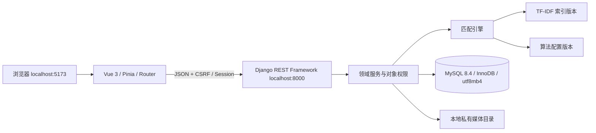
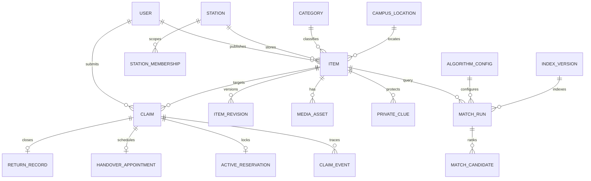

# 02 架构与数据库设计

## 1. 系统架构

前后端分离但使用同一站点会话语义：Django 负责 Session、CSRF、密码哈希、对象权限与审计；Vue 不持久化密码或长期令牌。算法层不直接依赖视图，以服务接口提供可测试能力。

## 2. Django 应用边界

| 应用 | 职责 |
|---|---|
| `accounts` | 自定义用户、角色、账户状态、登录会话 |
| `stations` | 校园地点、服务站、人员站点范围 |
| `items` | 类别、物品、版本、媒体、隐私线索、收藏与订阅 |
| `matching` | 配置、索引版本、运行、候选、反馈、离线评估 |
| `claims` | 认领、举证、预约、交接码、返还记录、状态事件 |
| `messaging` | 会话、参与者、消息和已读状态 |
| `notifications` | 站内通知及通知偏好 |
| `content` | 公告、帮助文章 |
| `administration` | 审计日志、持久任务、举报与报表快照 |

## 3. 核心实体关系

## 4. 并发与一致性

- “一件招领物同一时刻最多一个有效保留”由 `ActiveReservation(found_item)` 唯一约束兜底。
- 审批认领时使用 `transaction.atomic()` 与 `select_for_update()` 锁定目标物品及相关有效保留记录。
- 物品公开版本与编辑版本分离：已审核内容被编辑后产生新版本，不直接污染公开快照。
- 交接码只保存不可逆摘要，包含过期时间与最多 5 次尝试；完成返还需领取方与协调员双方确认。
- 所有管理写操作在同一事务中写入 `AuditLog`，包括操作者、对象、动作、前后差异摘要和请求关联 ID。

## 5. MySQL 约束

- MySQL 8.4 LTS，InnoDB，数据库与连接均使用 `utf8mb4`。
- 时间统一以 UTC 入库，API 输出 ISO 8601，前端按 Asia/Shanghai 展示。
- 金额、经纬度、评分等禁止使用不受控浮点表示；匹配分数保存为指定精度的小数。
- 开发环境不以 SQLite 替代正式验收数据库；若 MySQL 未启动，相关门禁必须标记为 `BLOCKED`。
